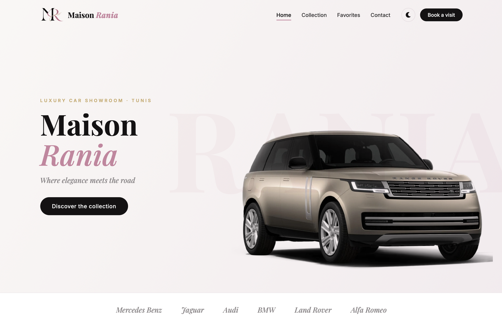
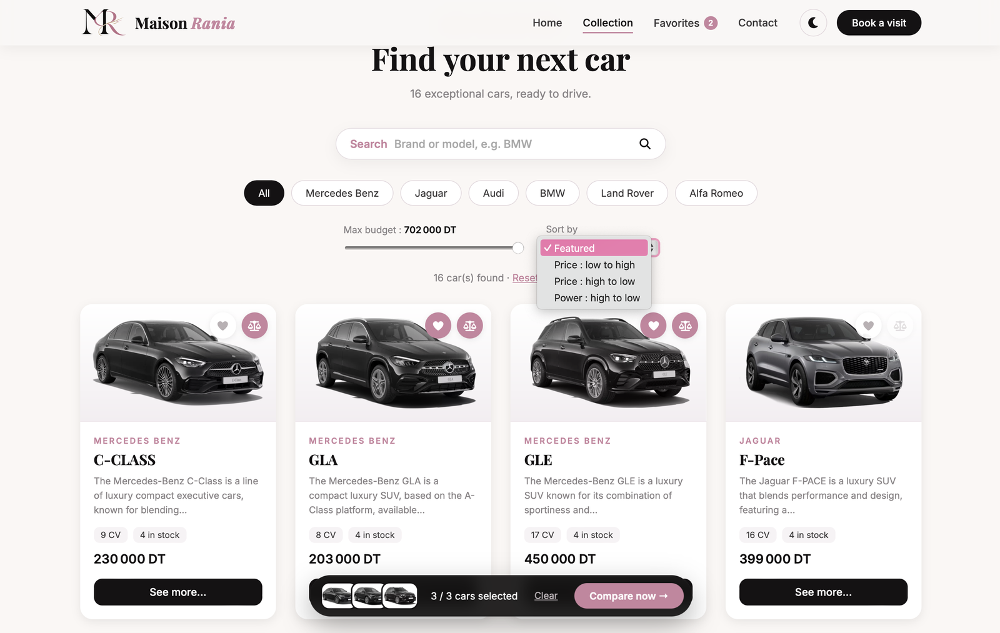
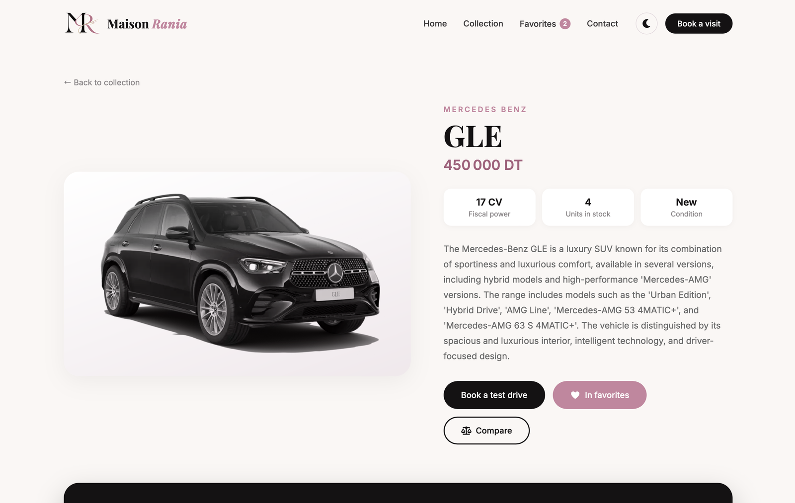
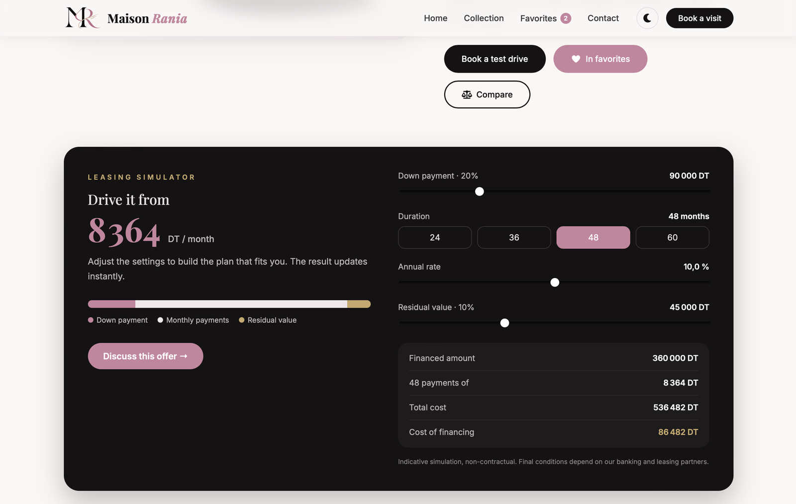
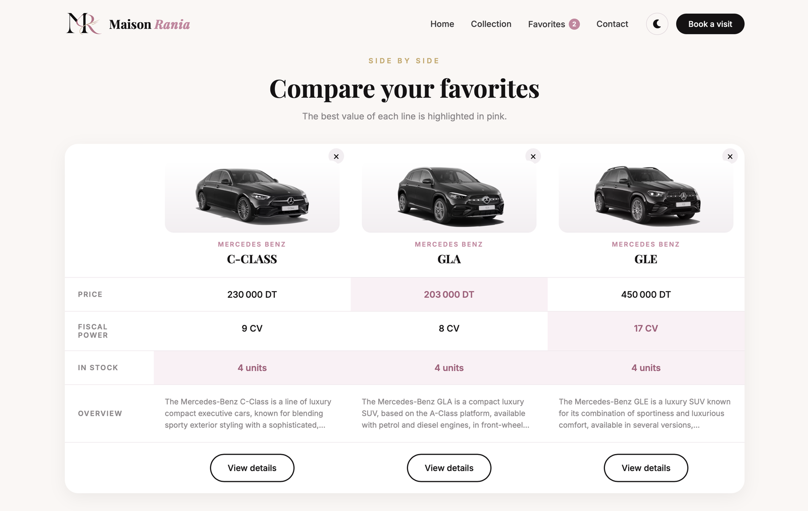
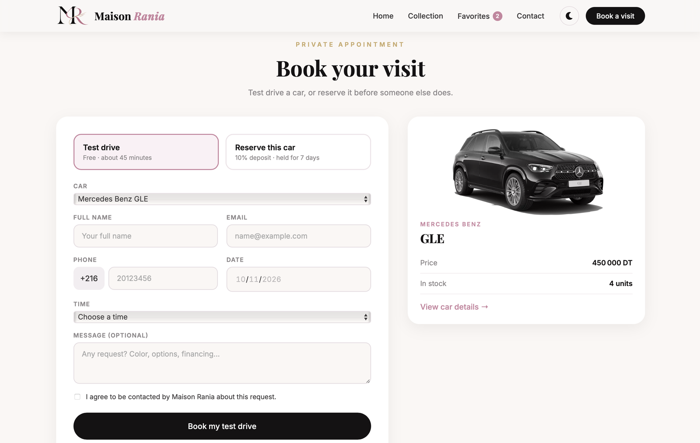
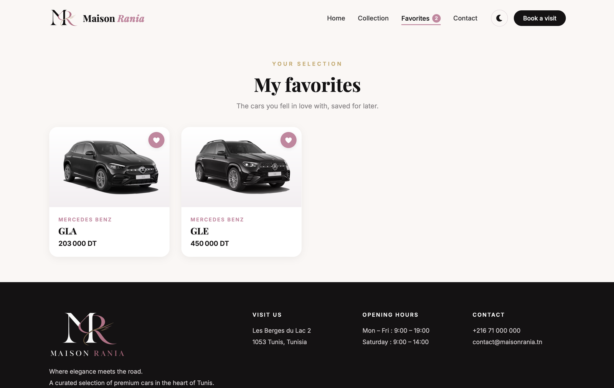
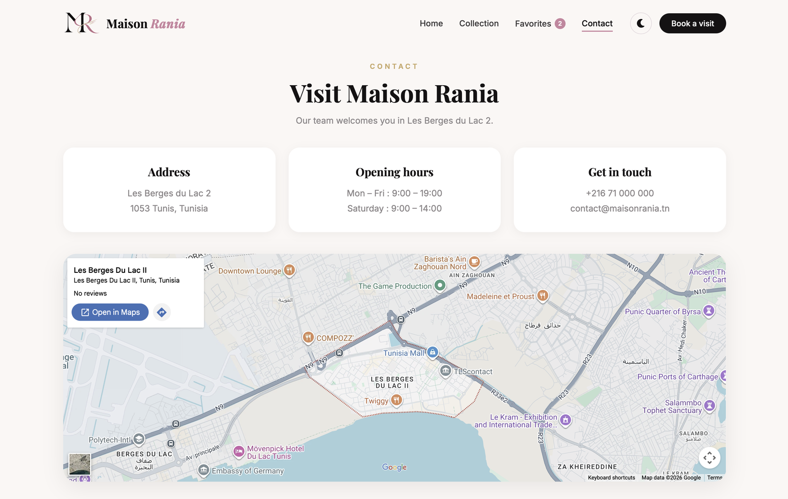

# Maison Rania — Showroom automobile

Application Angular réalisée dans le cadre du TP « Showroom-auto » du module *Framework de développement web* (3BI, IHEC Carthage, 2026-2027).

**Site en ligne :** [https://rania-benbrahim.github.io/showroom-auto/](https://rania-benbrahim.github.io/showroom-auto/)



## Le projet

Maison Rania est un showroom de voitures de luxe fictif, situé aux Berges du Lac 2 à Tunis. À partir du TP de base (recherche par marque et affichage des détails d'une voiture), l'application a été enrichie pour devenir un site complet.

## Fonctionnalités

- **Recherche et filtres** : recherche par marque ou modèle, filtre par marque, budget maximum et tri.
- **Fiche détaillée** pour chaque voiture, avec des suggestions de la même marque.
- **Favoris** sauvegardés dans le navigateur.
- **Comparateur** de 2 à 3 voitures, avec mise en évidence des meilleures valeurs.
- **Formulaire de réservation** (essai ou réservation avec acompte), avec validation des champs.
- **Simulateur de leasing** : apport, durée, taux et valeur résiduelle, avec calcul instantané de la mensualité et du coût du financement.
- **Mode sombre** et **version mobile** avec menu burger.

## Aperçu

### Collection : recherche, filtres, tri et sélection pour comparer


### Fiche détaillée


### Simulateur de leasing


### Comparateur


### Réservation d'un essai ou d'une voiture


<table>
<tr>
<th>Favoris</th>
<th>Contact</th>
</tr>
<tr>
<td valign="top"></td>
<td valign="top"></td>
</tr>
</table>

## Notions Angular utilisées

- Composants et communication parent/enfant avec `@Input` et `@Output` / `EventEmitter`
- Nouveau contrôle de flux : `@for`, `@if`, `@else`, `@empty`
- Data binding : interpolation, property binding, event binding, style et class binding
- Services et injection de dépendances (`CarService`, `FavoritesService`, `CompareService`, `AppointmentService`, `ThemeService`)
- Observables RxJS (`BehaviorSubject`, `combineLatest`) et pipe `async`
- Routage avec paramètres (`/car/:id`), paramètres de requête (`?brand=BMW`) et `routerLinkActive`
- Pipes intégrés (`number`, `date`) et pipe personnalisé (`truncate`)
- Reactive Forms avec validateurs intégrés et validateur personnalisé
- Interfaces TypeScript (`Auto`, `Appointment`) et sauvegarde avec `localStorage`

## Lancer le projet en local

```
npm install
ng serve
```

Puis ouvrir [http://localhost:4200](http://localhost:4200)

## Autrice

**Rania Ben Brahim** — 3BI, IHEC Carthage
